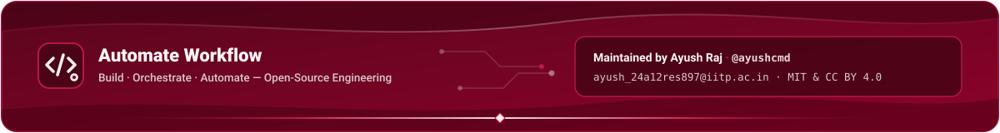

<p align="center">
  
</p>

# Automate Workflow — `.github`

This repository hosts the organization-wide profile README and brand assets for **[Automate Workflow](https://github.com/Automate-Workflow)**, maintained by **Ayush Raj** ([`@ayushcmd`](https://github.com/ayushcmd)).

## Structure

```text
.github/
├── README.md                  # Repository overview (this file)
└── profile/
    ├── README.md              # Organization profile page rendered at github.com/Automate-Workflow
    └── assets/
        ├── header.svg         # Crimson hero header banner matching official logo
        ├── footer.svg         # Crimson footer banner with maintainer attribution
        ├── divider.svg        # Crimson gradient section divider
        └── logo.svg           # Vector Automate Workflow emblem
```

## Core Repositories

- [`ai-agent-hub`](https://github.com/Automate-Workflow/ai-agent-hub) — Primary-sourced visual knowledge base for AI agents
- [`n8n-projects`](https://github.com/Automate-Workflow/n8n-projects) — Curated production n8n workflow projects
- [`mail-out`](https://github.com/Automate-Workflow/mail-out) — Client-side Chrome Extension (Manifest V3) for Gmail powered by Gemini
- [`automation-tools`](https://github.com/Automate-Workflow/automation-tools) — Curated directory of 99 automation tools across 13 categories

## Contact

- **Owner:** Ayush Raj ([`@ayushcmd`](https://github.com/ayushcmd))
- **Email:** [`ayush_24a12res897@iitp.ac.in`](mailto:ayush_24a12res897@iitp.ac.in)

<p align="center">
  
</p>

