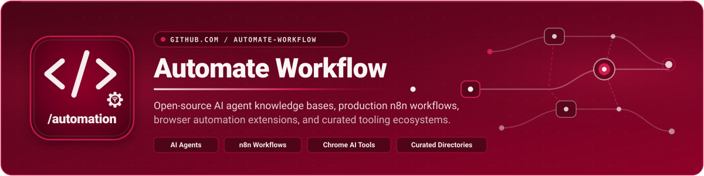
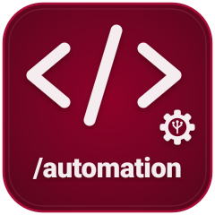
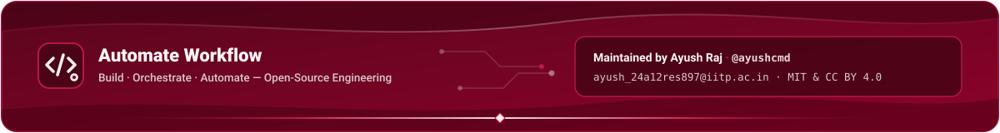

  

  
  
  
  
  

  

## About Automate Workflow

**Automate Workflow** is an open-source engineering organization dedicated to building practical, verifiable, and production-ready systems across **AI Agent Architectures**, **n8n Workflow Automation**, **Client-Side Browser AI**, and **Curated Automation Tooling**.

Every repository in the organization emphasizes structured engineering clarity — combining reproducible datasets, schema-validated pipelines, clean visual documentation, and real-world developer workflows.

  

## Core Repositories

> Live repository telemetry below updates automatically via GitHub API badges as stars, forks, and commits grow.

<table>
  <thead>
    <tr>
      <th align="left" width="24%">Repository</th>
      <th align="left" width="46%">Overview &amp; Key Scope</th>
      <th align="left" width="30%">Stars, Forks &amp; Stack</th>
    </tr>
  </thead>
  <tbody>
    <tr>
      <td valign="top">
        <a href="https://github.com/Automate-Workflow/ai-agent-hub"><strong>ai-agent-hub</strong></a> 
        <code>Knowledge Base · Agentic AI</code>  
        
      </td>
      <td valign="top">
        The standalone, primary-sourced, visual knowledge base for AI agents — types, concepts, architectures, patterns, open protocols (<code>MCP</code>, <code>A2A</code>), tooling, safety risks, evaluations, and guided learning paths.  
        <strong>Highlights:</strong> 136 concepts · 35 patterns · 55 frameworks · Interactive offline explorer
      </td>
      <td valign="top">
        
         
        
        
      </td>
    </tr>
    <tr>
      <td valign="top">
        <a href="https://github.com/Automate-Workflow/n8n-projects"><strong>n8n-projects</strong></a> 
        <code>Workflow Blueprints · n8n</code>
      </td>
      <td valign="top">
        Curated n8n projects to learn production automation across WhatsApp, LinkedIn, HR, text classification, voice, computer vision, video, and research workflows.  
        <strong>Highlights:</strong> 50 curated projects · 4-phase learning path · Automated CI link &amp; schema checks
      </td>
      <td valign="top">
        
         
        
        
      </td>
    </tr>
    <tr>
      <td valign="top">
        <a href="https://github.com/Automate-Workflow/mail-out"><strong>mail-out</strong></a> 
        <code>Chrome Extension · Gemini AI</code>
      </td>
      <td valign="top">
        <strong>MailOut AI</strong> — Client-side Chrome Extension (Manifest V3) for Gmail with Gemini-powered 3-bullet summarization, email categorization, hybrid spam scoring, and quick reply templates.  
        <strong>Highlights:</strong> Zero server storage · Heuristic + AI spam engine · One-click compose templates
      </td>
      <td valign="top">
        
         
        
        
      </td>
    </tr>
    <tr>
      <td valign="top">
        <a href="https://github.com/Automate-Workflow/automation-tools"><strong>automation-tools</strong></a> 
        <code>Open Directory · DevOps &amp; RPA</code>
      </td>
      <td valign="top">
        A curated directory of 99 automation tools across 13 categories: workflow automation, orchestration, data pipelines, CI/CD, GitOps, IaC, RPA, browser automation, and AI agents.  
        <strong>Highlights:</strong> 99 tools · 13 categories · CSV-driven deterministic Markdown &amp; SVG generation
      </td>
      <td valign="top">
        
         
        
        
      </td>
    </tr>
  </tbody>
</table>

  

## Engineering Focus & Stack

| Pillar | Focus Area | Core Technologies |
| :--- | :--- | :--- |
| **Agentic Systems** | Multi-agent architectures, open protocols (`MCP`, `A2A`), safety, and evaluation | `Python` · `JSON Schema` · `RAG` · `SVG Visualizations` |
| **Workflow Orchestration** | End-to-end n8n integrations across messaging, voice, vision, and research | `n8n` · `Python` · `GitHub Actions` · `Webhooks` |
| **Client-Side AI Tools** | Privacy-first browser extensions executing directly in the user's browser | `JavaScript` · `Chrome Manifest V3` · `Gemini API` · `Gmail UI` |
| **Automation Ecosystems** | Verified tool taxonomies across CI/CD, GitOps, IaC, RPA, and data pipelines | `Python` · `CSV Pipelines` · `CI Link Verification` |

  

## Owner & Maintainer

<table>
  <tr>
    <td width="110" align="center" valign="middle">
      
    </td>
    <td valign="middle">
      <strong>Ayush Raj</strong> — Founder &amp; Lead Maintainer 
      Indian Institute of Technology (IIT) Patna · B.S. Computer Science &amp; Data Analytics ('28)  
      
      
      
      
    </td>
  </tr>
</table>

  

## Contributing & Governance

- **Contributions**: Pull requests, curated entries, workflow blueprints, and documentation improvements are welcome — review each repository's `CONTRIBUTING.md` before opening a PR.
- **Security**: Report security concerns, leaked credentials, or suspicious upstream links privately via repository **GitHub Security Advisories** or directly to [`ayush_24a12res897@iitp.ac.in`](mailto:ayush_24a12res897@iitp.ac.in).
- **Licensing**: Code across organization repositories is licensed under **MIT**; curated knowledge datasets and documentation in `ai-agent-hub` are additionally licensed under **CC BY 4.0**.

  

